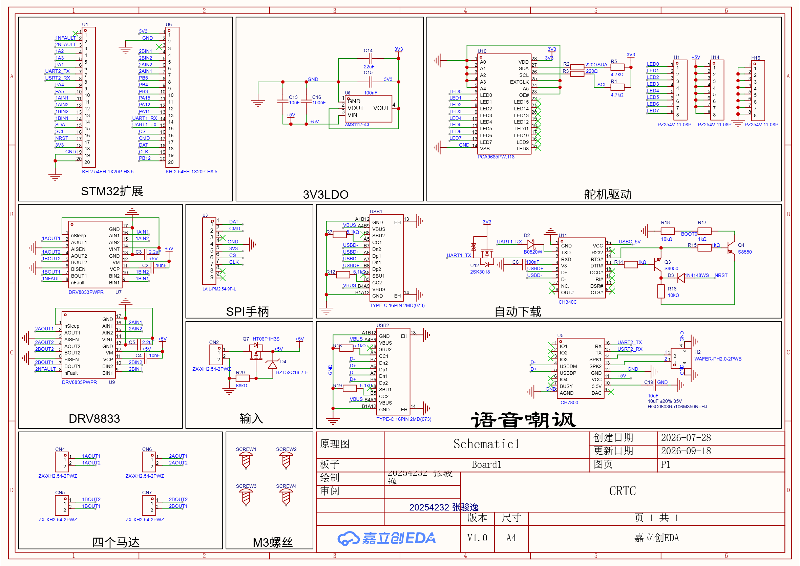
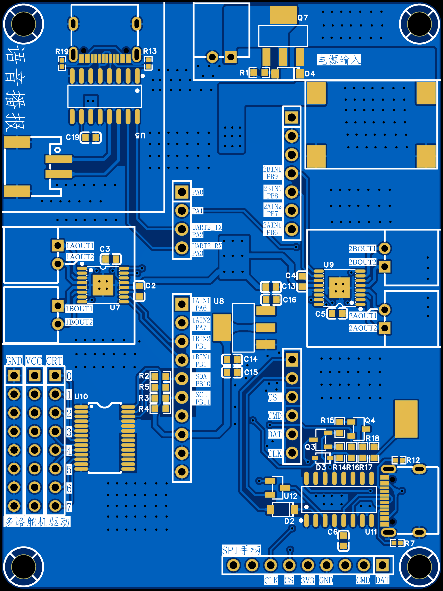
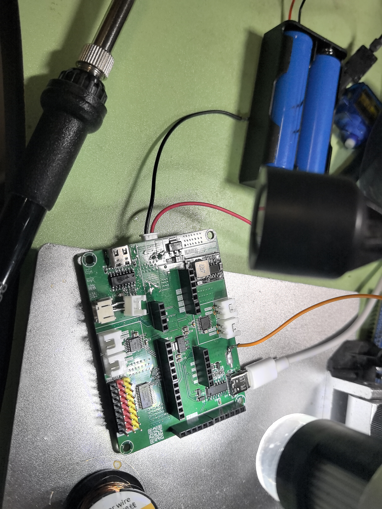
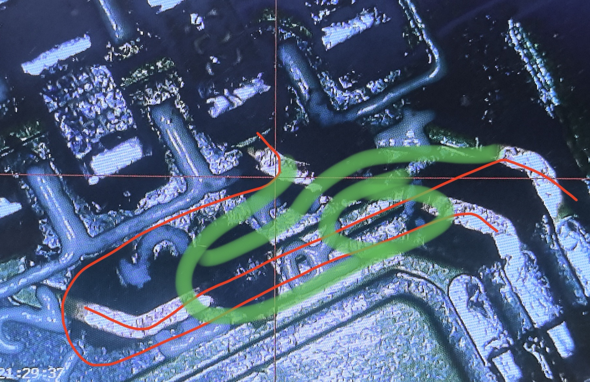
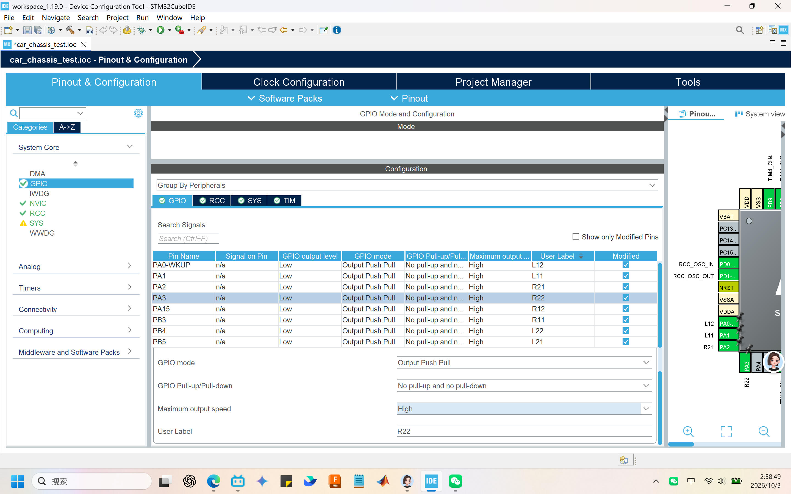

# 比比拉布队造车日志

# 9\.18晚

硬件歪比巴卜同学根据2026CRTC参赛手册V1\.3中所列元器件绘制第一版BCP板。

硬件设计思路：

电源部分使用2节18650电池供电，实测电压8\.4V。经过PMOS防反接进入Mini降压模块（5V）再通过AMS1117\-3V3输出3V3。5V供电给四个TT马达，语音模块与舵机驱动；3V3供电给ST最小系统板，自动下载电路与所有逻辑通信高电平。

控制部分采用市面上成熟方案STM32F103C8T6最小系统板引出对应引脚排针，引出UART1供自动下载以及上位机通信；引出SPI2与PS2手柄进行通信，同时考虑到硬件NSS（CS）有许多坑，故采用软件NSS；引出UART3与舵机驱动芯片通信；引出UART2与语音模块通信；采用TIM3四个PWM通道控制左侧两个TT马达，可以自由的设置调节速度的方式，同时使用TIM4四个PWM通道控制右侧两个TT马达。

布线部分注意了电源线加粗；信号线类差分走线，包地走线；保证LDO输入输出电容回路可在顶层回流到地；打缝合孔增强电气性能；修铜处理尖角和孤岛并保证地完整性。

# 9\.26晚24

机械出图

# 9\.27晚

装好车

硬件歪比巴卜同学焊接了第一块板子，并进行测试，选取比比拉布和奶龙大笑阴笑作为音频输出，测试CH340自动下载电路正常，测试舵机驱动芯片时发现IIC通信两根线画反了，飞线补救🤓

# 10\.1

电控刀盾同学千辛万苦重新下软件，把新老ide、mx、vscode、clion全配了一遍，鉴定为吃饱了撑的

# 10\.2

刀盾跟着豆老师进行一些配置，搭工程框架

## 选芯片建项目

## 配SYS

1. 点左侧 **System Core**，点开下拉，选择 **SYS**

2. 在右侧 SYS 配置面板： 

    - Debug：下拉框选择 **Serial Wire**

    - Timebase Source：保持 **SysTick** 不动

## 配置RCC外部高速晶振

1. 左侧 `System Core` → 点开 **RCC**

2. 在右侧 RCC 面板： High Speed Clock \(HSE\) 下拉，选择 **Crystal/Ceramic Resonator**

## 调时钟树

HCLK那里直接输72然后enter

## 配方向引脚

## 生成工程

Code Generator 选项卡，generated files全勾选

很奇怪。这个版本的cubeIDE右上角没有generate code，只能从菜单栏里点

## 测试代码

/\* USER CODE BEGIN 2 \*/后粘贴正反转测试代码

# 10\.3上电测

试n多次失败n多次后终于想起来查看接线。回家手边没有万用表，于是用tt马达充当蜂鸣档万用表，发现电机不转是因为给pcb板供电的电池盒焊线时虚焊了，刀盾同学小发雷霆！

# 10\.4

也是发动人脉找到焊接工具  重焊了一遍电池盒

手边没有电表于是拿tt马达当蜂鸣档用了  测了发现通断方面没有问题

# 10\.5

不信邪  把从打开CUBEIDE开始到烧录的所有操作录屏发给实训战队的电控组长求帮排查问题。

向硬件要来板子文件之后  发现是电驱一直处于休眠状态  原来是硬件问题！电控刀盾同学勃然小怒！歇之

# 10\.9

刀盾同学用新板子搞定麦轮正反转，实测前进、后退、侧向移动正常

# 10\.10

刀盾同学在codex老师指导下实现I2C 驱动 PCA9685，实现大臂/小臂/夹子三路舵机的角度映射、限位与上电归位，遇到上电后机械臂干涉导致舵机卡死的问题，把舵盘拆了重装遂解决该问题

# 10\.11

调手柄

SPI读取PS2手柄，完成帧同步与按键、摇杆解析，实现手柄遥控

# 10\.12

机械调整结构，加入云台

补断连刹车、舵机保持与 I2C 发送失败重试

# 10\.13

从原工程移植，改正LF/LR平移符号（之前的用起来没问题，但是代码里的符号和实际是反的，要加功能的话比较麻烦，很容易搞反）

